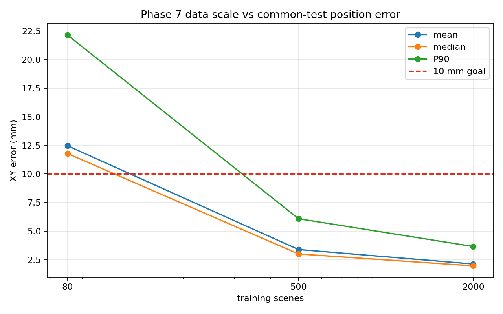
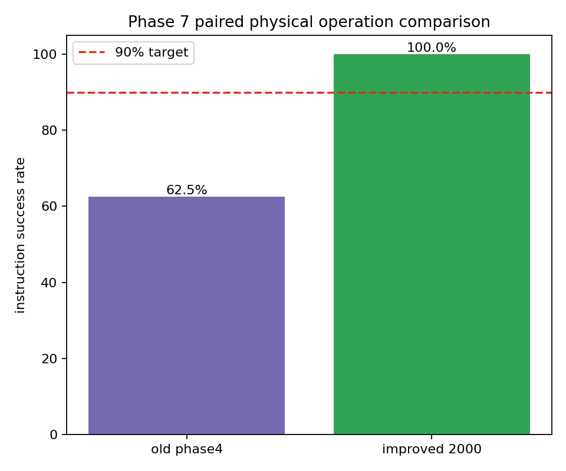
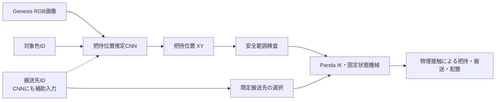

# 視覚AIを用いたPandaロボットアームの物体把持・搬送

**Vision-Based Object Grasping and Transport with a Franka Panda**

Physical AI応用1講座の最終課題です。Genesis 1.2.1の固定カメラRGB画像から、小型CNNが
対象色IDで指定された立方体の把持位置XYを推定します。推定XYは真値で補正せず、Franka
Pandaの固定状態機械へ渡され、IKと物理接触によって把持・搬送・配置を実行します。

CNNが学習するのは把持位置XYです。手先姿勢、Z高さ、搬送先選択、IK、関節補間、
グリッパー力、動作タイミングは従来型制御が担当します。Data Scaling（学習データ量の比較）は
追加の性能評価で、
Trainシーンを80から2,000へ増やすと共通Testの平均位置誤差は12.48 mmから2.14 mmへ低下し、
同一24配置での物理操作成功率は62.5%から100%へ改善しました。

> 100%は評価した24配置に限る結果です。固定カメラ、赤・青・緑の立方体、構造化指示、
> 開ループ制御という条件であり、一般環境での成功を意味しません。

## 主な結果

| Trainシーン数 | 共通Test平均誤差 | 中央値 | P90 | 10 mm以内 |
|---:|---:|---:|---:|---:|
| 80 | 12.478 mm | 11.799 mm | 22.157 mm | 40.4% |
| 500 | 3.402 mm | 3.014 mm | 6.096 mm | 99.3% |
| 2,000 | **2.137 mm** | **1.976 mm** | **3.666 mm** | **100.0%** |

| モデル | 同一24配置の成功数 | 成功率 | 平均把持位置誤差 |
|---|---:|---:|---:|
| 旧モデル（Train 80） | 15/24 | 62.5% | 13.059 mm |
| 改善モデル（Train 2,000） | **24/24** | **100.0%** | **2.190 mm** |

両モデルには同じseed、物体配置、対象色、搬送先を使用し、初期物体位置の最大差は0.0 mmでした。
旧モデルの失敗9件はいずれも把持段階で、改善モデルでは9件すべて成功しました。





## システム構成



| 要素 | 担当 |
|---|---|
| 対象色に応じた物体選択、把持位置XY推定 | 視覚AI |
| 手先姿勢、Z高さ、搬送先座標の選択 | 固定設定・状態機械 |
| IK、関節補間、関節位置制御 | 従来型制御 |
| 二指グリッパーの把持力、動作タイミング | 固定力制御・状態機械 |
| 真値座標 | 学習ラベル・独立評価・可視化のみ |

現行モデルはRGB画像、対象色ID、搬送先IDを入力し、正規化された把持位置XYだけを出力します。
搬送先IDは4次元EmbeddingとしてCNNの回帰器にも入力されますが、同じ対象色に対する教師把持XYは
左右搬送先で同一です。実際に左右で動作を変える処理は、搬送先IDから既定座標を選ぶ状態機械側に
あります。CNNは関節軌道、把持力、搬送先座標、動作タイミングを生成しません。

## デモとレポート

- [最終レポートPDF](output/pdf/physical-ai-goal-conditioned-final-report.pdf)
- [最終レポートMarkdown](docs/final-report.md)
- 提出用デモ動画: `videos/physical-ai-goal-conditioned-final-demo-enhanced.mp4`
  （81.20秒、4つの独立試行、指示・推定座標・動作状態・評価説明付きのローカル生成物）
- 旧88秒版バックアップ: `videos/physical-ai-goal-conditioned-final-demo-88s-backup.mp4`
- 提出用動画URL: [PAI最終課題_140354](https://youtu.be/eC-p8nsFTk4)
  （81.20秒、4つの独立試行モンタージュ版）

動画ファイル自体はGit管理対象外です。

## 使用環境

| 用途 | Prefix | Python | PyTorch | Genesis | バックエンド |
|---|---|---:|---:|---:|---|
| シミュレーション・推論 | `.venv-sim` | 3.10 | 2.8.0 CPU | 1.2.1 | CPU |
| CNN学習 | `.venv-train` | 3.10 | 2.8.0+cu126 | 使用しない | CUDA（GTX 1050 4GB） |

GenesisのCUDA物理は標準経路にせず、CNN学習のみCUDA環境で実施します。既存のConda環境や
グローバル環境を変更しない構成です。

## セットアップ

PowerShellで実行します。

```powershell
Set-ExecutionPolicy -Scope Process Bypass
.\setup-sim.ps1
.\setup-train.ps1
```

プロジェクト内prefixのPythonを常に明示してください。環境確認:

```powershell
.\.venv-sim\python.exe -m pai_goal_conditioned.check_env --mode sim
.\.venv-train\python.exe -m pai_goal_conditioned.check_env --mode train
```

## データ生成

固定カメラと3色の立方体を使い、1シーンにつき3物体×2搬送先の6構造化指示を生成します。画像取得前に
物理的に安定化し、重なり・不可視・座標不整合を除外します。Train/Validation/Testはシーン単位で
分割され、同一画像の指示が分割をまたぎません。同一対象の左右搬送先サンプルは同じ教師把持XYを
持つため、1シーン当たり異なる把持位置教師は3点です。

100シーンの基本データ:

```powershell
.\.venv-sim\python.exe -m pai_goal_conditioned.phase3_dataset
```

フェーズ7の2,500シーンmasterデータ（Train 2,000 / Validation 250 / Test 250）:

```powershell
.\.venv-sim\python.exe -m pai_goal_conditioned.phase3_dataset `
  --config configs\phase7_dataset.json
```

生成物は`datasets/`以下へ保存され、Git管理されません。設定、seed、配置、カメラ情報、ラベルの
有効性、生成時間をmanifestへ記録します。

## 学習

49,366パラメータの構造を固定し、データ量だけを変えて比較します。AdamW、Smooth L1 Loss、
Validation LossによるEarly Stoppingを使用し、正規化値は各Train splitのみから計算します。

```powershell
.\.venv-train\python.exe -m pai_goal_conditioned.phase4_train `
  --config configs\phase4_training.json --stage train

.\.venv-train\python.exe -m pai_goal_conditioned.phase7_train `
  --config configs\phase7_training.json --stage train
```

モデル重みは`models/`以下へ`state_dict`として保存され、Git管理されません。

## 再現可能な評価

オフライン共通Test比較:

```powershell
.\.venv-train\python.exe -m pai_goal_conditioned.phase4_train `
  --config configs\phase4_training.json --stage evaluate

.\.venv-train\python.exe -m pai_goal_conditioned.phase7_train `
  --config configs\phase7_training.json --stage evaluate
```

旧モデルと改善モデルの同一24配置オンライン評価:

```powershell
.\.venv-sim\python.exe -m pai_goal_conditioned.phase5_online `
  --config configs\phase7_physical_old.json
.\.venv-sim\python.exe -m pai_goal_conditioned.phase5_online `
  --config configs\phase7_physical_improved.json
.\.venv-sim\python.exe -m pai_goal_conditioned.phase7_compare
```

最終レポートと動画の再構築:

```powershell
.\.venv-sim\python.exe scripts\build_final_report.py
.\.venv-sim\python.exe -m pai_goal_conditioned.phase8_record_trial `
  --config configs\phase7_physical_improved.json --seed 90000 `
  --target-class red_cube --destination-id left_bin --model-label improved_train2000 `
  --output-video recordings\phase8\improved_trial01.mp4 `
  --output-json recordings\phase8\improved_trial01.json
.\.venv-sim\python.exe scripts\build_enhanced_final_video.py
```

動画比較には同じコマンドを旧モデル設定でも実行します。収録コードは制御やモデルを変更せず、
カメラフレームを保存するだけです。

## 品質検証

```powershell
.\.venv-sim\python.exe -m ruff check src tests scripts
.\.venv-sim\python.exe -m pytest -q
.\.venv-sim\python.exe -m pai_goal_conditioned.check_env --mode sim
.\.venv-sim\python.exe -m pai_goal_conditioned.smoke_test
.\.venv-train\python.exe -m pai_goal_conditioned.check_env --mode train
```

主要な結果はJSON/CSVの集計値とレポート・READMEの図表を照合します。

## ディレクトリ構成

```text
configs/                    実験設定
docs/                       フェーズ別・最終報告書と公開用図
src/pai_goal_conditioned/   シミュレーション、学習、評価コード
tests/                      単体テスト
scripts/                    最終PDF・動画の構築スクリプト
datasets/                   生成データ（Git対象外）
models/                     学習済み重み（Git対象外）
outputs/                    実験結果（Git対象外）
recordings/, videos/        収録・動画（Git対象外）
```

## 制約と今後の課題

- カメラは固定で、対象は同寸法の赤・青・緑の立方体です。
- 指示は対象色IDと搬送先IDであり、自由文理解は行いません。
- 推論後は開ループで、再認識、再試行、閉ループ失敗回復はありません。
- OpenCV等の非学習画像処理との正式な物理比較は行っておらず、CNNが本条件で必須だったとは
  結論しません。
- 未知形状、遮蔽、照明・背景変化、実機へのSim-to-Realは未評価です。
- 24/24成功は限定された共通評価集合であり、統計的な一般成功率ではありません。

今後は評価seedと物体形状の拡張、カメラ・照明のdomain randomization、不確実性推定、閉ループ
再認識、実機キャリブレーションを段階的に検証する必要があります。

## ライセンス

第三者ソフトウェア・アセットの確認結果は[THIRD_PARTY_NOTICES.md](THIRD_PARTY_NOTICES.md)を
参照してください。Genesisおよび同梱PandaアセットはApache License 2.0、PyTorchはBSD
3-Clauseです。本リポジトリで作成したソースコードは[MIT License](LICENSE)で公開します。

## 開発記録

各フェーズの詳細は`docs/phase0-phase1-report.md`から`docs/phase7-report.md`、作業記録は
`worklogs/`にあります。仮想環境、キャッシュ、大容量データ、モデル、動画は`.gitignore`で除外します。
