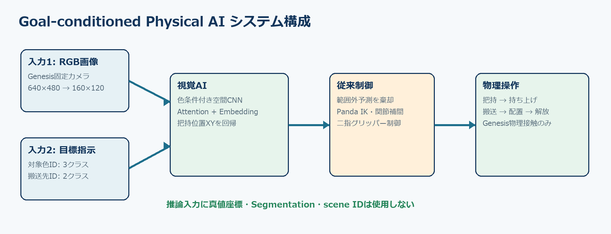
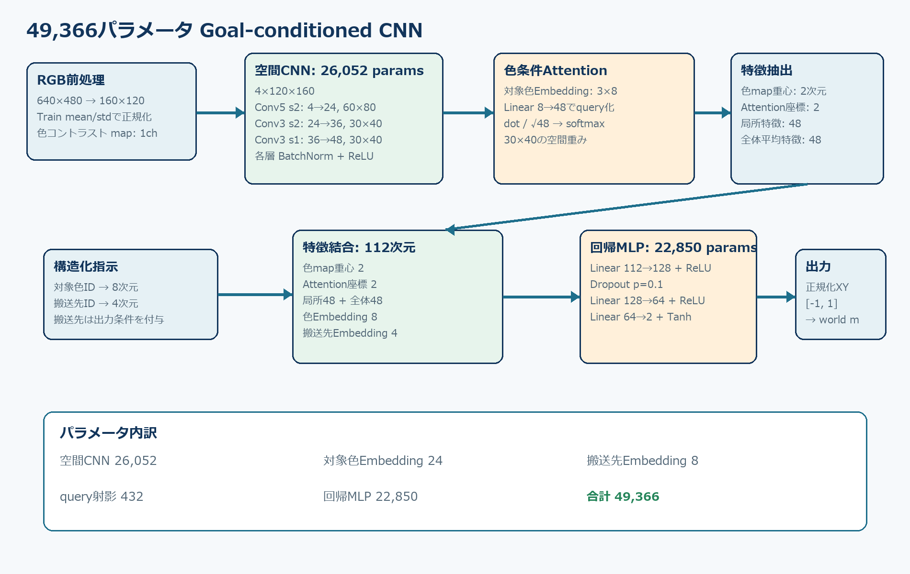
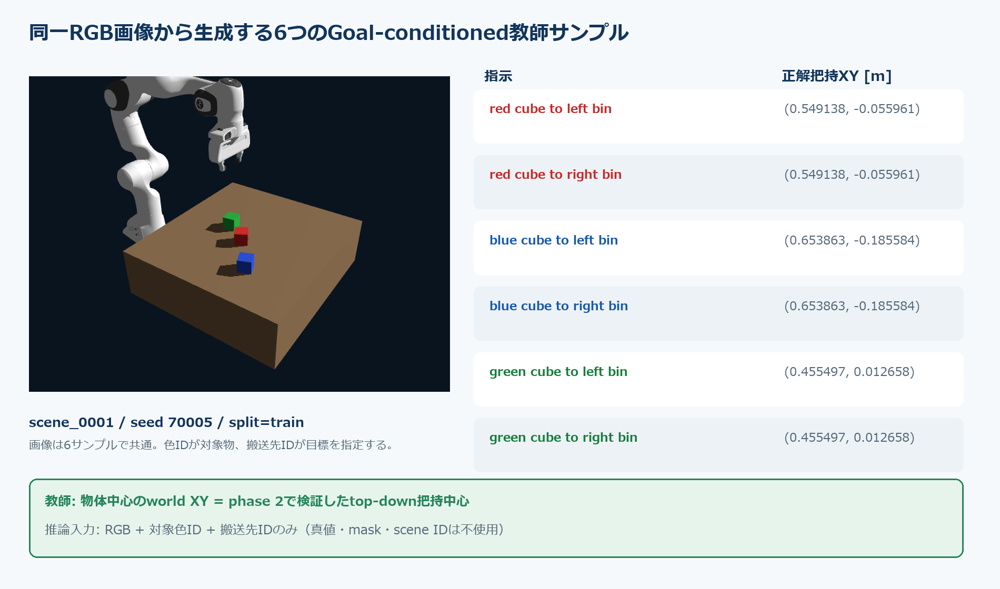
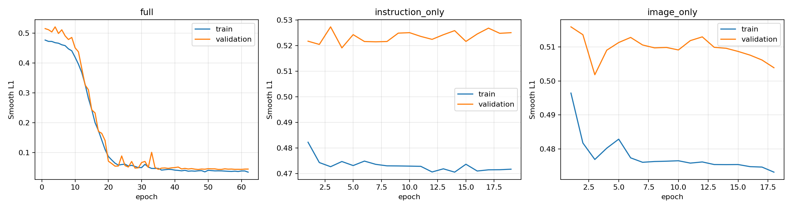
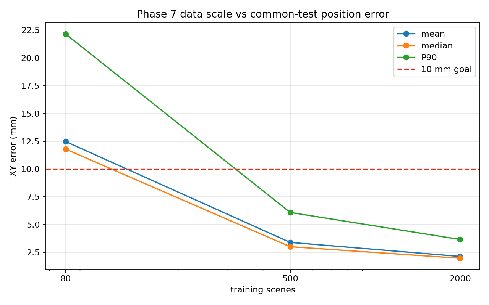
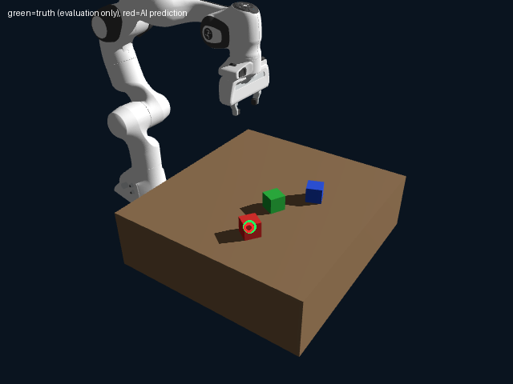
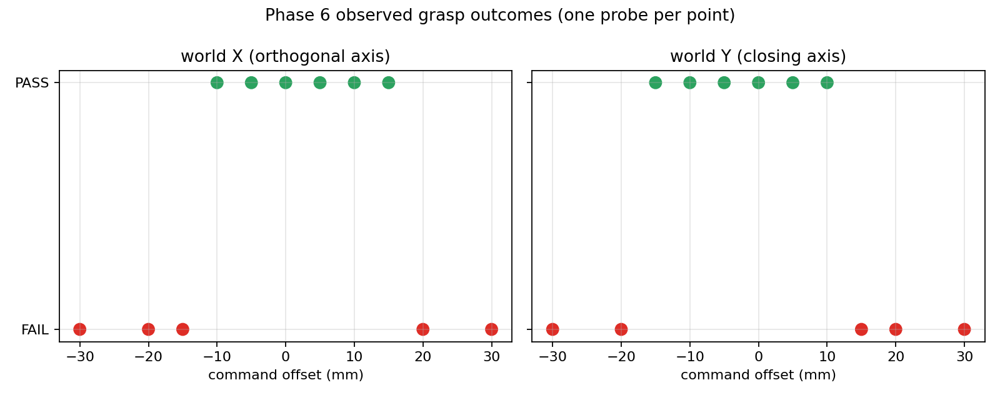
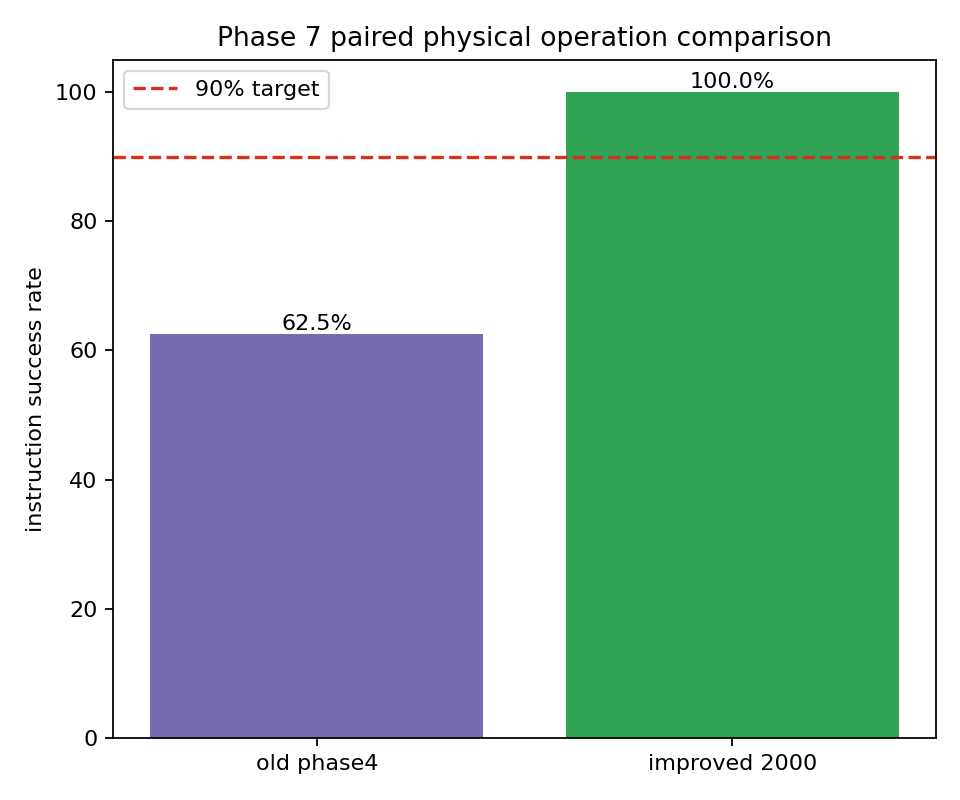
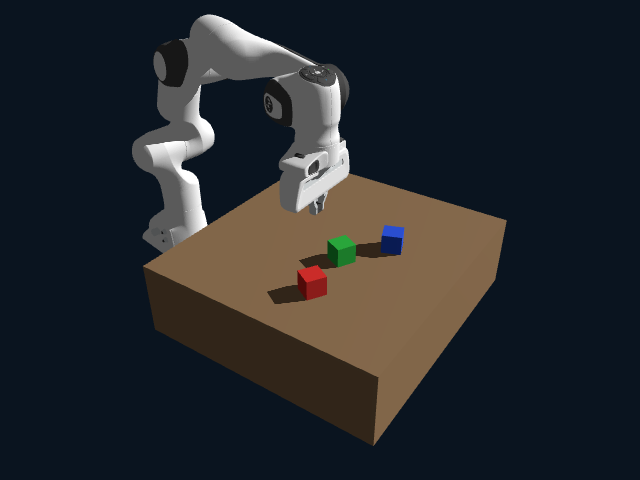
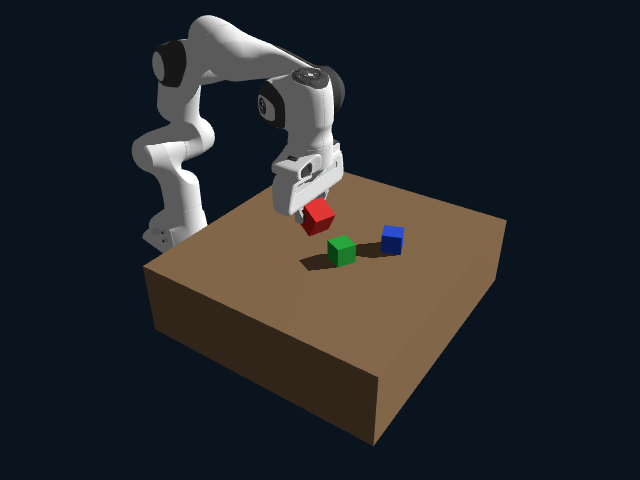

# 視覚・目標条件付きAIによるロボットアームの自律物体操作と学習データ拡張による把持性能改善

Goal-Conditioned Visual Robotic Manipulation: Improving Physical Task Success through Data Scaling

---

## 1. 背景と研究目的

Physical AIでは、画像認識の精度だけでなく、認識結果が物理世界で実際に役立つかを検証する
必要がある。本課題では、RGB画像と目標指示から操作対象の把持位置を推定し、ロボットアームが
物理接触によって対象を把持・搬送・配置するGoal-conditionedシステムを構築した。

研究目的は次の3点である。

- Genesis 1.2.1のCPU物理上で、Franka Pandaの再現可能な把持・搬送基盤を構築する。
- RGB画像と対象色・搬送先の構造化指示から、対象物のワールド座標XYを推定する小型CNNを学習する。
- 教師データ量を増やしたとき、オフライン位置精度だけでなく物理操作成功率も改善するかを検証する。

開発はフェーズ0から7まで段階的に行った。独立環境、IK、固定座標Pick and Place、教師データ生成、
視覚AI学習、オンライン統合、失敗原因分析、データ増量比較の順で、前段階を検証してから次へ進んだ。

本課題の中心的な問いは「位置推定誤差を小さくすれば、実際の把持成功率も改善するか」である。
最終的に、同一24配置のペア評価によりこの関係を検証した。

## 2. Goal-conditioned Physical AIのシステム構成

システムは学習ベースの視覚推論と従来制御を分離した階層型Physical AIとして構成した。対象色IDは
視覚AIが操作対象を特定するために使い、AIが直接決定するのは固定カメラのRGB画像上で選択した対象物の
把持位置XYである。Pandaの手先姿勢、Z高さ、IK、関節補間、グリッパー力制御は従来制御が担当する。

本システムでは、目標条件付き視覚AIが指示された対象物の把持位置を推定し、搬送先IDに対応する移動動作を
下位制御器が実行する。搬送先IDはモデル入力にも含まれるが、同じ対象色に対する把持XYの教師ラベルは
左右の搬送先で変化しない。搬送先への軌道は状態機械、IK、関節制御によって生成され、ニューラルネット
ワークが搬送経路や関節制御指令を直接学習・生成する構成ではない。この点で、連続行動系列を直接出力する
VLA型モデルとは異なる。

入力はRGB、対象色ID、搬送先IDのみである。推論時に物体真値、Segmentation、scene ID、正解把持点を
使わない。真値はデータ生成ラベルと独立評価に限定した。AI予測を真値で補正せず、ワークスペース外の
予測だけを安全に棄却する。

Pandaの動作状態は、初期姿勢、対象上方、下降、グリッパー閉、持ち上げ、搬送、配置、開放、退避、
静止確認で構成した。フェーズ5と7のオンライン評価では再認識、再試行、閉ループ補正を行っていない。

## 3. GenesisとFranka Pandaの物理シミュレーション

標準シミュレーションはGenesis 1.2.1 CPUバックエンドを使用した。学習だけを独立したCUDA版
PyTorch環境とGTX 1050で実行し、既存Conda環境や他プロジェクトから分離した。

| 項目 | 設定 |
|---|---|
| 物理エンジン | Genesis 1.2.1、CPU |
| ロボット | Franka Emika Panda、7軸 + 二指グリッパー |
| テーブル | 0.65 x 0.70 x 0.20 m |
| 対象物 | 50 mm立方体、赤・青・緑 |
| 物体密度 | 500 kg/m3 |
| 摩擦係数 | 1.0 |
| シミュレーションdt | 0.01 s、2 substeps |
| カメラ | 640 x 480、固定、FOV 43度 |
| 把持姿勢 | 垂直上方からのtop-down grasp |

フェーズ1では5目標姿勢すべてに到達し、最終位置誤差4.58から5.84 mm、姿勢誤差0.62から0.74度を
得た。フェーズ2では固定座標の立方体を10/10試行で把持・搬送・配置し、配置水平誤差は全試行
3.41 mmだった。これにより、AIを導入する前の物理操作基盤が成立していることを確認した。

把持中は腕を関節位置制御、二指を各指-1.0 Nの力制御とした。物体の初期配置後は直接移動や固定を
行わず、持ち上げ・搬送・配置は物理接触だけで実現した。

## 4. 自作CNNの構造と学習データ

### 4.1 ネットワーク全体構造

自作Fullモデルは49,366 trainable parametersの小型Goal-conditioned CNNである。実装では、固定カメラの
RGB画像、対象色ID、搬送先IDを受け取り、把持中心のワールド座標XYを2次元回帰する。画像は640 x 480から
160 x 120へbilinear resizeし、Train splitだけから求めたチャンネル別mean/stdで標準化する。

画像テンソルの形状は3 x 120 x 160である。色条件から生成する1チャンネルのコントラストマップを連結し、
4 x 120 x 160を空間CNNへ入力する。畳み込み部は次の3段で、各Convの直後にBatchNormとReLUを置く。

| 層 | kernel / stride / padding | 入出力channel | 特徴マップ H x W |
|---|---|---:|---:|
| 入力 | - | 4 | 120 x 160 |
| Conv1 | 5 x 5 / 2 / 2 | 4 → 24 | 60 x 80 |
| Conv2 | 3 x 3 / 2 / 1 | 24 → 36 | 30 x 40 |
| Conv3 | 3 x 3 / 1 / 1 | 36 → 48 | 30 x 40 |

色コントラストは正規化画像を一度Train mean/stdで逆変換し、0から1へclampしたRGBから計算する。各画素で
red = R - max(G, B)、blue = B - max(R, G)、green = G - max(R, B)を求め、対象色IDに対応するmapを
選ぶ。最終mapはReLU(contrast - 0.18)であり、色差が0.18以下の背景を抑える。この処理はRGB値と
対象色IDのみを使い、Segmentation maskは使わない。mapの重み付き重心を160 x 120上の[-1, 1]座標で
求め、2次元のmask XY特徴とする。分母は最小1e-6にclampして空map時の除算を防ぐ。

対象色Embeddingは3クラス x 8次元である。8次元ベクトルをLinear 8 → 48でqueryへ射影し、48 x 30 x 40の
特徴mapとのchannel方向の内積をsqrt(48)で割る。このlogitを1,200セル全体でsoftmaxし、色指示に対応する
空間Attentionを得る。Attentionから、[-1, 1]座標の重心2次元と、重み付き局所特徴48次元を計算する。
同時に特徴mapのglobal average poolingから全体特徴48次元を得る。

搬送先Embeddingはleft_bin / right_binの2クラス x 4次元で、目標条件を回帰器へ与える。把持XYの教師値は
同じ色物体なら左右搬送先で同一であり、実際の搬送先軌道は下流の状態機械が生成する。一方、モデル入力
仕様として搬送先条件を保持することで、RGB・対象色・搬送先というGoal-conditioned表現を統一している。

回帰器へ入る特徴は、色map重心2、Attention重心2、局所特徴48、全体特徴48、対象色Embedding 8、
搬送先Embedding 4の合計112次元である。MLPはLinear 112 → 128、ReLU、Dropout 0.1、
Linear 128 → 64、ReLU、Linear 64 → 2、Tanhで構成し、[-1, 1]の正規化XYを出力する。

| 構成要素 | trainable parameters |
|---|---:|
| 空間CNN（Conv + BatchNorm） | 26,052 |
| 対象色Embedding（3 x 8） | 24 |
| 搬送先Embedding（2 x 4） | 8 |
| Attention query射影（8 → 48） | 432 |
| 回帰MLP（112 → 128 → 64 → 2） | 22,850 |
| 合計 | 49,366 |

XYの正規化はTrain splitの各軸最小値minと最大値maxを使い、n = 2 (x - min) / (max - min) - 1とする。
推論後はx = (n + 1) / 2 (max - min) + minでワールドmへ戻す。フェーズ4のTrain 80シーンでは
X=[0.404241, 0.699629] m、Y=[-0.217919, 0.078037] mを使用した。フェーズ7のTrain 2,000では
X=[0.400000, 0.699935] m、Y=[-0.219968, 0.079867] mである。画像mean/stdもTrain限定で計算し、
Train 2,000ではmean=[0.150663, 0.161264, 0.173977]、std=[0.201521, 0.161307, 0.129137]だった。

### 4.2 Genesisによる教師データ生成

Genesis 1.2.1 CPU上にPanda、0.65 x 0.70 x 0.20 mのテーブル、50 mmの赤・青・緑立方体を配置した。
固定カメラは640 x 480、位置[1.25, -1.10, 1.05] m、look-at [0.53, -0.04, 0.22] m、FOV 43度である。
各立方体中心はX=[0.40, 0.70] m、Y=[-0.22, 0.08] mから一様乱数で選び、物体間中心距離を
0.10 m以上とした。位置候補は最大200回探索し、各物体のyawも[-pi, pi]でランダム化した。

初期配置後はdt=0.01 s、2 substepsで40 step進めて安定化する。物体中心Zは支持面上で約0.224945 mで、
教師把持XYは対象物の真値中心XYそのものである。これはフェーズ2の10/10成功で検証した垂直top-down
把持に対応し、hand目標は[truth X, truth Y, truth Z + 0.110] m、姿勢quaternionは[0, 1, 0, 0]である。

同一RGB画像から、3対象色 x 2搬送先の6サンプルを作る。例えばscene_0001、seed 70005では、赤、青、
緑の把持XYがそれぞれ(0.549138, -0.055961)、(0.653863, -0.185584)、
(0.455497, 0.012658) mである。左右搬送先は把持対象を変えないため、同色の2指示は同じ把持XYを持つ。

学習ラベル作成時は物理シミュレーションの対象物真値とSegmentationを利用する。Segmentationは可視性QAと
確認画像だけに使い、学習・推論画像へ追加しない。推論時の入力はRGB、対象色ID、搬送先IDだけであり、
真値座標、Segmentation、scene ID、正解把持位置をモデルへ渡さない。

シーン全体をseed付きでshuffleし、画像単位ではなくscene単位でTrain/Validation/Testへ割り当てる。
フェーズ3は80/10/10シーン、フェーズ7は2,000/250/250シーンである。したがって、同じRGB画像を共有する
6指示が異なるsplitへ漏れることはない。フェーズ7のsplit seedは71777で、split漏洩は0件だった。

各候補シーンは、全物体の可視画素100以上、支持高さ誤差8 mm以内、線速度0.02 m/s以下を要求する。
不合格なら理由とseedをmanifestへ記録し、sceneごとに最大5回、seedを変えて再生成する。フェーズ7では
無効attempt 40件を除外・再生成し、最終2,500シーン・15,000サンプルは全ラベル有効だった。

### 4.3 学習手順とモデル選択

OptimizerはAdamW、初期学習率0.001、weight decay 0.0001、batch size 32である。Validation Lossが
5 epoch改善しない場合、ReduceLROnPlateauで学習率を0.5倍にする。最大100 epochとし、Validation Lossが
1e-5以上改善しない状態が15 epoch続いた時点でEarly Stoppingする。最良Validation Lossを更新したepochの
state_dictだけを保存し、Testはモデル選択、Early Stopping、ハイパーパラメータ調整に使用しない。

損失は正規化XYに対するSmooth L1 Loss、beta=0.1である。誤差dについて|d| < betaなら
0.5 d^2 / beta、それ以外は|d| - 0.5 betaとし、batchとXY成分で平均する。実装にはAttention cellの
cross entropyを加算できる経路もあるが、実験設定のattention_loss_weightは0.0であり、本結果では回帰損失
だけを最適化した。

再現性のため、Python、NumPy、PyTorch、CUDAのseedを固定し、cuDNN deterministicとPyTorchの
deterministic algorithmsを有効にした。フェーズ4はseed 4100、フェーズ7は学習seed 7100、入れ子部分集合の
seed 7177である。DataLoaderもseed付きgenerator、num_workers=0で構成した。

| 実験 | best epoch / 実行epoch | 学習時間 | peak GPU allocated / reserved |
|---|---:|---:|---:|
| フェーズ4 Full（80 scenes） | 47 / 62 | 30.819 s | 201.8 / 304.0 MiB |
| フェーズ7 Train 80 | 87 / 100 | 129.098 s | 201.8 / 304.0 MiB |
| フェーズ7 Train 500 | 97 / 100 | 368.327 s | 201.8 / 304.0 MiB |
| フェーズ7 Train 2,000 | 49 / 64 | 791.547 s | 202.0 / 304.0 MiB |

フェーズ4のLoss曲線では、FullモデルだけがTrain/Validationともに大きく低下し、指示のみ・画像のみでは
Validation Lossが約0.5付近に残った。Fullモデルのbest epochは47、best Validation Lossは0.043267だった。

### 4.4 フェーズ4アブレーション実験

フェーズ4のTest 10シーン・60サンプルで、Full、指示のみ、画像のみを別々に学習・評価した。Fullは画像と
両Embeddingを使う。instruction_onlyは画像を使わず、image_onlyは対象色・搬送先を使わない。同じ画像に
複数の正解把持点があるため、どちらか一方の情報だけでは対象を一意に決められない。

| フェーズ4モデル | 入力 | Test平均XY誤差 |
|---|---|---:|
| Full | RGB + 対象色ID + 搬送先ID | 15.250 mm |
| 指示のみ | 対象色ID + 搬送先ID | 126.526 mm |
| 画像のみ | RGB | 127.825 mm |

この比較はフェーズ3の100シーンdatasetに含まれるフェーズ4 Testを使ったアブレーションである。後述する
フェーズ7の共通Test 250シーン・1,500サンプルとはdataset、seed、サンプル数が異なるため、数値を直接
混同しない。アブレーションはRGBと指示の両方が把持対象の選択に必要であることを示す。

## 5. 学習データ量による位置推定精度の比較

モデル構造、AdamW、Smooth L1 Loss、batch size 32、最大100 epoch、Early Stoppingを固定し、
Train scene数だけを80、500、2,000へ変更した。80は500の部分集合、500は2,000の部分集合である。
Validation 250シーンと最終Test 250シーンは完全に共通とした。正規化値は各Train部分集合だけから
算出し、Testはモデル選択に使用していない。

| Train scenes | 平均誤差 | 中央値 | P90 | 10 mm以内 | 15 mm以内 | 20 mm以内 |
|---:|---:|---:|---:|---:|---:|---:|
| 80 | 12.478 mm | 11.799 | 22.157 | 40.4% | 66.9% | 85.7% |
| 500 | 3.402 mm | 3.014 | 6.096 | 99.3% | 99.9% | 100% |
| 2,000 | 2.137 mm | 1.976 | 3.666 | 100% | 100% | 100% |

Train 2,000モデルのX方向平均絶対誤差は1.274 mm、Y方向は1.456 mm、X/YのP90は
2.747/2.906 mmだった。色別平均は赤1.955 mm、青2.136 mm、緑2.321 mmである。

学習時間は80、500、2,000シーンで129.098、368.327、791.547秒、GPU peak allocatedは
201.8、201.8、202.0 MiBだった。パラメータ数を増やさず、データ量だけで位置精度を改善できた。

## 6. オンライン物理操作実験

フェーズ4モデルをGenesisカメラとフェーズ2の物理操作へ統合した。未知配置10試行のフェーズ5評価では、
平均推定誤差14.911 mm、指示達成7/10だった。成功7試行の配置誤差は平均8.004 mm、最大19.067 mmで、
3失敗はすべて把持段階だった。

同じ画像で対象色指示だけを変えると予測点が変わること、推論APIへ真値・Segmentation・scene IDが
渡らないこと、予測XYが真値補正されないことを単体テストで確認した。CPU推論は平均約10 msで、
物理操作時間に対して十分小さかった。

## 7. 把持失敗の原因分析

フェーズ5で失敗した試行1、5、10を同じseed・配置・指示で再実行し、3/3件の失敗を再現した。
同じ条件で診断用真値XYを使うと3/3件すべて把持に成功したため、主因をCNNの位置推定誤差と判断した。

方向分解では、試行1はグリッパー開閉方向Yの+17.4 mmが支配的、試行10は直交方向Xの+15.4 mmが
支配的だった。試行5はX=-31.0 mm、Y=-29.0 mmの各成分だけでも失敗した。

代表配置で各点1回のオフセット掃引を行った結果、観測された連続成功区間はX=-10から+15 mm、
Y=-15から+10 mmだった。絶対値5 mmと10 mmは各4/4成功、15 mmは2/4、20 mmと30 mmは0/4だった。
これは1配置・各点1試行の暫定的観測であり、普遍的な物理限界ではない。

失敗時は持ち上げ後のグリッパー幅が約0 mmまで閉じ、対象の持ち上げ量も約0 mmだった。真値把持時は
49.8から68.9 mmの幅が残り、対象を183から197 mm持ち上げた。これにより、誤差によって指と物体の
接触が成立しない現象を物理状態からも確認した。

## 8. 学習改善前後の物理操作成功率比較

旧フェーズ4モデルとTrain 2,000改善モデルを、seed 90000から90023の同一24配置で比較した。
対象色・搬送先の6組合せを各4回含み、2モデル間の全物体初期位置差は最大0.0 mmだった。
モデル以外のカメラ、物理、制御、成功判定は同一である。

| 指標 | 旧モデル | 改善モデル |
|---|---:|---:|
| 正しい対象を把持 | 15/24 | 24/24 |
| 持ち上げ | 15/24 | 24/24 |
| 搬送 | 15/24 | 24/24 |
| 配置 | 15/24 | 24/24 |
| 指示達成 | 62.5% | 100% |
| 平均把持位置誤差 | 13.059 mm | 2.190 mm |
| P90誤差 | 22.024 mm | 3.393 mm |
| X平均絶対誤差 | 8.124 mm | 1.288 mm |
| Y平均絶対誤差 | 8.481 mm | 1.470 mm |

旧モデルの9失敗はすべて把持段階であり、改善モデルはその9条件をすべて成功へ変えた。旧成功から
改善失敗への退行は0件だった。旧モデルの成功群は平均誤差9.267 mm、失敗群は19.378 mmだった。
改善モデルは全24件で平均2.190 mmとなり、フェーズ6で観測した許容範囲より十分小さかった。

旧モデルの試行1では赤立方体を持ち上げられなかったが、改善モデルは同じ配置で持ち上げに成功した。

| 旧モデル失敗 | 改善モデル成功 |
|---|---|
|  |  |

ここで得た成功率100%は、固定カメラ、3色の立方体、構造化指示、評価した24配置に限定された結果であり、
未検証条件への一般的な100%成功を意味しない。

## 9. 考察・制約・今後の課題

本実験では、モデル容量や学習方法を変えずにデータ量を増やすことで、共通Test平均誤差を
12.478 mmから2.137 mmへ、同一物理配置の成功率を62.5%から100%へ改善した。位置推定誤差が
把持失敗の主因であるというフェーズ6の分析と整合し、オフライン指標の改善が物理タスク成功へ
つながることを示した。

一方、次の制約がある。

- カメラ位置・姿勢は固定で、照明や背景のドメインランダム化を行っていない。
- 操作対象は同形状・同寸法の赤、青、緑の立方体に限定される。
- 指示は対象色IDと搬送先IDであり、自由文や曖昧な言語指示を扱わない。
- 把持は垂直top-downの固定姿勢で、物体姿勢に応じた把持方向を学習していない。
- 閉ループ再認識、失敗検出後の回復、自動リトライを実装していない。
- 物理成功率100%は評価した24配置に限られ、より広い配置や実機への一般化は未検証である。

今後は、カメラ・照明・背景・物体形状の多様化、予測不確実性による安全中断、グリッパー座標系の
方向別損失、再認識を用いた閉ループ補正、実機FrankaへのSim-to-Real検証が課題となる。自然言語を
構造化指示へ変換する処理も別レイヤとして追加できるが、本課題では対象外とした。

## 10. まとめ

Genesis 1.2.1上にFranka PandaのIK・物理把持・搬送基盤を構築し、RGB画像と目標指示から把持位置を
推定する49,366パラメータのGoal-conditioned CNNを統合した。フェーズ0から7まで、物理基盤、データ、
学習、オンライン統合、原因分析、改善評価を段階的に検証した。

教師データを80から500、2,000 Trainシーンへ増やすことで、共通Test平均誤差を12.478 mmから
2.137 mmへ改善した。同一24配置の物理評価では旧モデル15/24、改善モデル24/24となり、位置精度改善が
実際の把持・搬送成功率を向上させた。固定条件内では、目標の位置誤差10 mm以下と物理成功率90%程度を
ともに達成した。

本課題の成果は、認識精度だけで完結せず、AI予測を物理操作へ接続し、失敗を方向別に分析し、データ
増量による改善を同一条件の物理実験で確認した点にある。

## 参考ソフトウェアと再現性

- Genesis 1.2.1: CPU物理シミュレーション
- PyTorch 2.8.0: CNN学習・CPU推論
- Franka Emika Panda MJCF: Genesis同梱モデル
- Python 3.10、GTX 1050 4GB

実験設定、seed、JSON/CSV結果、再現コマンドはリポジトリ内の設定・報告書・READMEへ保存した。
大容量データセット、仮想環境、学習済み重み、生動画はGit管理対象外とした。
